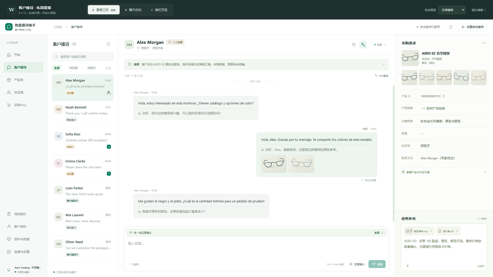
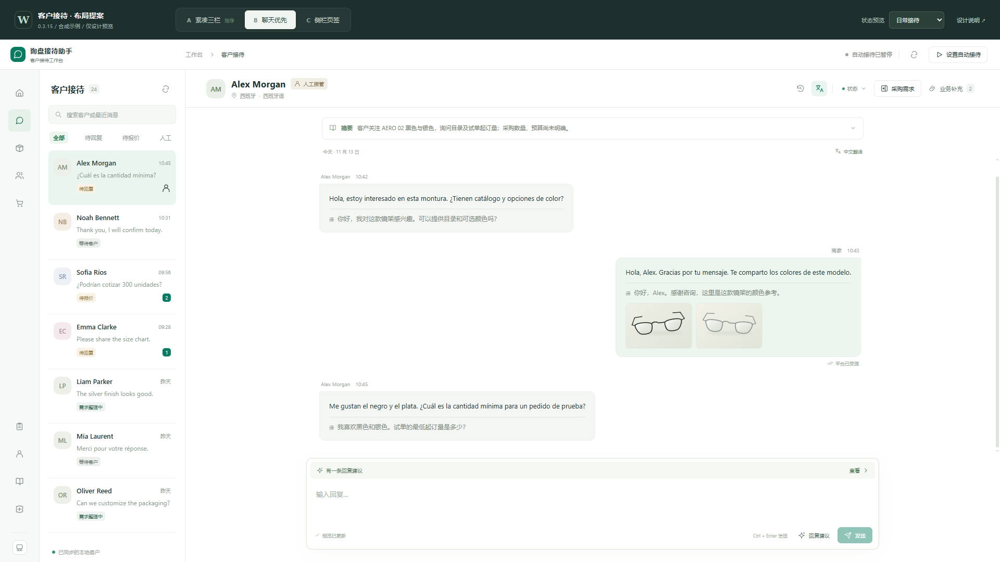
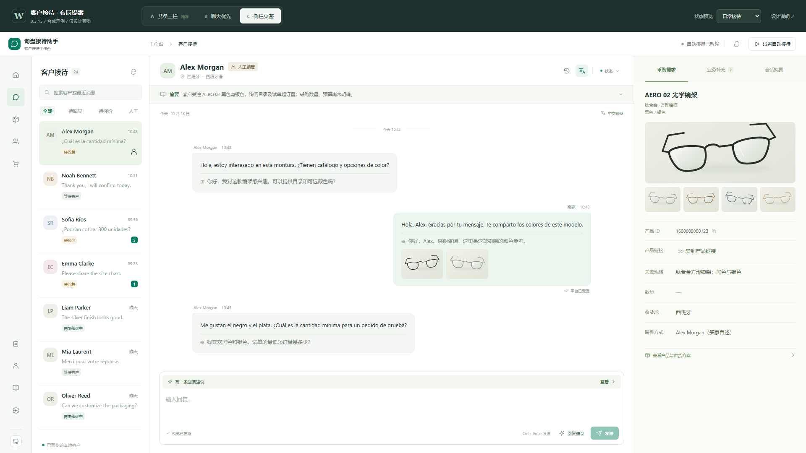

# 0.3.15 客户接待界面设计稿

日期：2026-11-13。供日常接待人员选择布局、后续开发及验收人员细化交互使用。

状态：三版独立设计原型，尚未选定或接入正式程序。配合 [0.3.15 开发方案](0.3.15开发方案.md)阅读。

浏览器打开 [交互预览](design/0.3.15/index.html)，在顶部切换 A、B、C。页面使用合成客户、聊天、商品插图和状态，不读取商家数据、不启动业务后台、不调用模型或发送消息。

## 共用调整

根据界面批注，三版共同执行以下设计：

- 将当前客户接管状态放到会话标题旁；历史覆盖、翻译和其他常态信息放入顶部工具及状态弹层，避免重复占用聊天区域。
- 全局暂停、当前客户接管、AI 能力、历史覆盖分别展示各自状态，不能互相推导。
- 移除回复区的“回复客户”标题行和底部长段说明，保存状态、建议操作与发送按钮整合在同一行。
- 回复框默认高度收紧，后续正式实现可随内容增高并设上限；聊天记录使用剩余高度。
- AI 建议按需展开，采用后写入输入框；生成、采用和发送保持各自含义。
- 会话摘要默认一行，点击展开；长摘要不持续挤占消息空间。
- 商品图片支持五张预览和放大切换，产品链接以短操作展示，避免长 URL 撑开右栏。
- 业务补充使用附件卡片、文字与左下角“＋”组合的输入框；详细限制按需查看，出错时就地提示。
- 发送结果未知、断连、保存失败等需要处理的问题持续就近显示，保留核查或重试入口。正常信息精简不削弱业务规则或操作限制。

## A：紧凑三栏（推荐）

[查看原尺寸](design/0.3.15/previews/a-compact.png) · [1440 × 900 窗口](design/0.3.15/previews/a-compact-1440.png)

保留左侧客户列表、中间聊天、右侧需求与业务补充同时可见的结构。宽屏保留导航文字，较窄窗口收起为图标。右栏采用紧凑商品信息、五张等尺寸缩略图和底部复合补充框。

适合一边聊天一边核对需求、频繁填写业务补充的现有工作方式。需求和补充均可直接操作，切换步骤少。相比另外两版，聊天横向空间较少。

## B：聊天优先

[查看原尺寸](design/0.3.15/previews/b-focus.png) · [展开客户资料](design/0.3.15/previews/b-focus-details.png)

默认只保留导航、客户列表和宽聊天区。消息及输入区设阅读宽度，避免句子横跨整个屏幕。右上方“采购需求”和“业务补充”按需打开资料抽屉，可在抽屉内切换页签。

适合多数时间阅读消息和人工回复、偶尔查看需求的工作方式。聊天最清爽；频繁比对需求和回复时，需要开关抽屉，抽屉展开也会遮住部分聊天。

## C：侧栏页签

[查看原尺寸](design/0.3.15/previews/c-tabs.png) · [业务补充页签](design/0.3.15/previews/c-tabs-supplement.png) · [1440 × 900 窗口](design/0.3.15/previews/c-tabs-1440.png)

右侧保持固定位置，将采购需求、业务补充、会话摘要放进三个页签。采购需求采用一张大图和四张缩略图的图片组；业务补充页签提供更大的编辑空间。切换页签保留当前预览编辑。

适合需要较大商品图、较长业务补充的工作方式。单个资料区更完整，页面同时出现的内容少；需求和补充不能同时看到。

## 选择对照

| 维度 | A 紧凑三栏 | B 聊天优先 | C 侧栏页签 |
| --- | --- | --- | --- |
| 聊天空间 | 中等，信息同时可见 | 最大，按阅读宽度排消息 | 中等，右栏保持固定 |
| 查看需求 | 直接可见 | 打开抽屉 | 采购需求页签 |
| 编辑补充 | 直接可见 | 打开抽屉并切页签 | 业务补充页签 |
| 五张图片 | 等尺寸缩略图 | 抽屉内五张缩略图 | 一张大图及四张缩略图 |
| 操作习惯变化 | 较小 | 较大 | 中等 |
| 推荐场景 | 日常接待、边聊边补充 | 阅读和人工聊天为主 | 较长补充、较多商品查看 |

建议优先选择 A，贴合当前接待流程；也可采用 A 的整体布局配合 C 的右侧页签。最终实现以用户选择为准，三版尚未合并为正式界面。

## 可体验范围与后续实现

交互预览可切换布局、展开摘要和会话状态、切换翻译显示、查看并采用合成建议、放大五张商品图片，以及打开抽屉和切换页签。业务补充可演示浏览器文件选择、文件拖入和剪贴板实际提供的文件接收；文件只保存在当前预览内存中。

Windows 本地文件复制产生的剪贴板格式、宿主文件接收、真实持久化、真实 AI 建议和发送均按正式开发方案单独实现及验证。预览按钮不能代表这些业务链路已经完成。

顶部“状态预览”可切换日常接待、发送结果未知、正文保存失败和服务断开。异常态示例：

- [发送结果未知及核查入口](design/0.3.15/previews/a-unknown.png)
- [保存失败及重试入口](design/0.3.15/previews/a-save-error.png)

设计预览不修改现行接待提示词、规则、授权或发送限制。本次不构建、打包或发布新版本。
