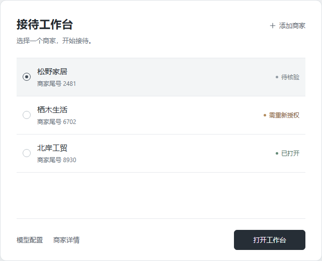
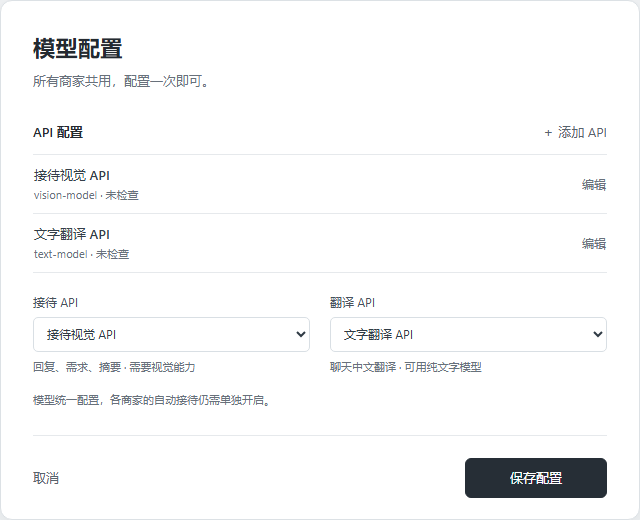
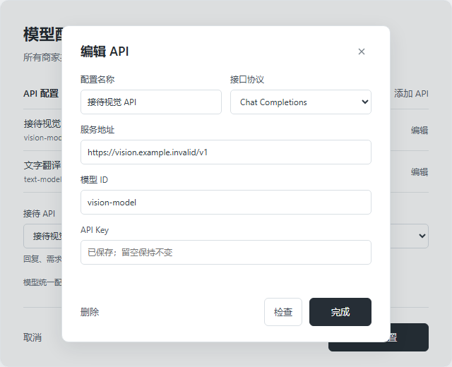
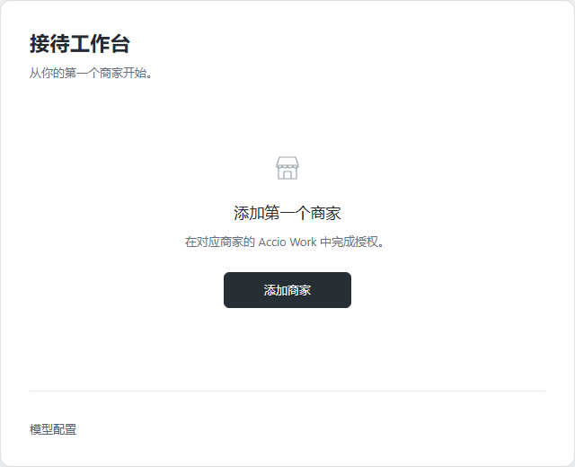
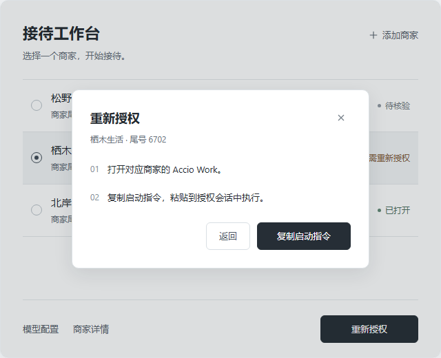
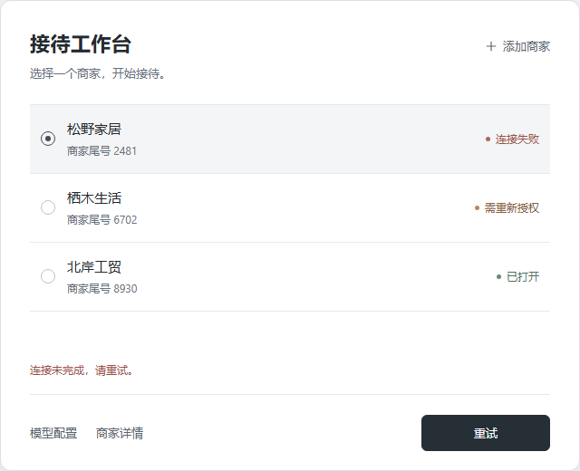

# 0.4.0 桌面启动器界面设计稿

日期：2026-11-15。界面面向日常接待人员，说明供产品、开发维护与验收人员使用。

状态：交互设计稿，不是已实现的正式客户端。当前运行源码仍为 0.3.21。本稿配合 [开发方案](0.4.0开发方案.md) 和 [多模态 API 设计](0.4.0第三方多模态API调用设计.md)。

## 1. 已确定的方向

正式版取消 Demo 模式，双击程序进入启动台。启动台负责选择已登记商家、添加或重新授权商家，以及为全部商家统一配置模型。

采用一个极简方案：约 640 × 520 的内容区，白色背景、深灰文字、细分隔线，每页一个主要操作。使用 Windows 原生标题栏；本稿截图为内容区。没有仪表盘、使用量大卡片、侧边导航或常驻诊断区。数据路径等次要信息按需查看。

[打开本地交互预览](design/0.4.0-launcher/index.html)。可用浏览器打开该 HTML；它不需要工作台桥，只用于审阅设计。页面下方的状态切换和说明不属于正式产品。

## 2. 日常启动

- 左上显示“接待工作台”，右上是次要操作“添加商家”。
- 每行只显示商家名称、账号尾号和必要状态。行内单选，方向键可切换；选择本身不启动工作区。
- 左下始终提供“模型配置”，有商家时另有“商家详情”。右下是随当前状态变化的主要按钮。
- 详情中显示数据位置、上次核验等信息；上次成功不等于当前授权仍有效。

| 当前状态 | 主要按钮 | 点击后的行为 |
| --- | --- | --- |
| 已登记、待核验 | 打开工作台 | 核验当前商家身份与读取能力，随后按原目录打开工作区 |
| 该商家窗口已运行 | 切回窗口 | 宿主确认目标窗口归属并激活，不启动第二个同商家服务 |
| 授权已失效或尚未完成可复用登记 | 重新授权 | 展示对应商家的 Accio 授权指引 |
| 正在打开 | 正在打开… | 禁止重复提交；保留取消入口和简短阶段文字 |
| 可重试的连接失败 | 重试 | 在原位说明失败，明确重试；不转入演示或新建替代工作区 |

工作台窗口确认就绪后关闭本次启动器窗口；失败则留在原处。关闭启动器不关闭其他已运行的商家。启动器不恢复任何商家的自动接待或采购授权，模型未配置也不阻止合法的普通人工聊天。

## 3. 全商家统一的模型配置

通过启动台左下“模型配置”进入同一窗口内的独立页面。页面明确显示“所有商家共用，配置一次即可”。这里的全部商家指本机同一 Windows 用户下的商家，不包含跨电脑或其他 Windows 用户同步。

上半部管理多个命名 API；下半部保留两个选择器：

| 用途 | 使用范围 | 模型要求 |
| --- | --- | --- |
| 接待 API | 国际站和 WhatsApp 回复、人工建议、润色、需求整理及摘要 | 具有视觉能力，并通过相应业务结构化检查 |
| 翻译 API | 聊天文字和有效人工建议的中文翻译 | 可以使用纯文字模型，不发送图片或完整接待上下文 |

两者可以选择不同服务商、不同模型，也可以明确选用同一条 API。列表支持添加多条配置；仅添加不自动选中。未配置或能力不满足时明确显示该用途未就绪，不偷偷借用另一用途的 API。

模型配置只维护这一份。商家工作台显示当前模型摘要和“在启动台管理”入口，不再提供商家专属覆盖。切换商家、改变业务目录或从不同入口启动，都使用相同全局选择。首次使用没有商家时，也可以先配置模型。

保存前显示实际影响：只改独立翻译 API，不暂停接待；修改接待选择或正在使用的接待配置时，提示“保存后，所有商家的自动接待将暂停，需按新配置重新开启”。修改未使用 API 或仅改名称不触发无关任务失效。各商家的身份、业务数据、用途启用和外发授权仍独立保存。

点击“保存配置”统一提交；“取消”放弃当前页面未保存的编辑。多个窗口并发修改时比较修订，冲突后刷新再编辑，不能静默覆盖别人的新值。启动台关闭后，业务进程仍能读取已保存配置，不要求此窗口常驻。

## 4. 添加和编辑 API

弹层仅包含配置名称、接口协议、服务地址、模型 ID、API Key 五项。实际可选协议以已实现适配器为准，样例名称不代表推荐或已验证的真实模型。

- 已存 Key 不回显，输入框留空表示保持不变；正式程序通过独立明确操作清除 Key，不用空字符串兼作保留和删除。
- “完成”将编辑纳入本页待保存配置；主页面“保存配置”后才对所有商家生效。
- “检查”是用户主动发起的操作；正式检查先说明用途、合成文字/图片以及可能产生 API 费用。保存和打开页面不自动发检查请求。
- 删除被引用的 API 时先提示改选或取消对应用途并保存；不默认改成列表第一条。未引用配置的删除须有明确确认。
- 显示能力“未检查/检查中/通过/失败”及适用范围，不用“连接成功”暗示视觉和业务质量均已通过。

全局配置与密钥保存在真实 Windows KnownFolder 的宿主存储；Key 使用当前 Windows 用户 DPAPI。API Key 与商家 Accio 授权环境分别管理，不进入商家业务备份，也不把密钥明文回传给页面。模型检查无需打开商家业务库或继承 Accio 授权。

## 5. 首次使用和重新授权

没有商家时显示“添加第一个商家”，主要按钮为“添加商家”，左下“模型配置”仍可使用。不创建样例商家、演示数据库或后台业务服务。

授权弹层只要求打开对应商家的 Accio Work，将启动指令粘贴到授权会话中执行。正式指令由宿主依据当前安装位置和启动契约生成；展示缓存不携带凭据，不靠手工填写 seller 或勾选“我已授权”跳过核验。新授权启动完成后，由宿主确认登记和目标窗口归属，再刷新状态。

从桌面长期复用 Accio 授权仍需验证令牌生命周期、网关依赖和 Accio 完全退出后的能力；本稿不承诺永久授权，也不因有商家索引就显示可用。相关边界见开发方案第 4.4 节。

## 6. 错误、键盘和小窗口

失败在原位用一句说明和可执行动作表达；身份不符、需要重新授权、目录缺失与普通网络失败分别路由，不能都变成无限重试。详细诊断按需打开，不在首页展示堆栈、工具路径、令牌状态或控制台日志。

商家列表支持方向键、Home/End 和单选焦点；按钮支持键盘操作。弹层有标题、焦点范围和 Escape 关闭，关闭后恢复焦点。状态同时使用文字和少量颜色，不只依赖彩色圆点。列表较长时只滚动列表/内容区，底部主要操作保持可见；小窗口和系统缩放需分别验证。

## 7. 正式实施与本次预览的边界

正式实施还需完成启动分派、商家索引、宿主专用 IPC、全局配置跨进程修订传播、DPAPI 存储、独立模型检查以及授权复用验证。启动器页面只能调用限定能力，不获得任意文件、shell 或业务通用 RPC。全局模型选择不合并客户上下文、图片或译文缓存，不扩大商家外发许可。

Demo 从生产入口、生产分派与发行闭包退出；离线测试保留独立合成夹具和专用 harness。旧 demo 目录不自动清理或迁入 live，也不为了删除模式而改写历史账本中的 mode/namespace。

本交互预览使用合成商家、保留的 `.invalid` 示例端点和内存状态；不读取真实配置、商家库或凭据，不调用 API、不写剪贴板、不执行启动指令。API 表单不保存输入的密钥，关闭或刷新预览后修改丢失。“打开”“切回”“授权返回”和“检查”仅模拟界面行为，不能作为真实登录、平台收发或模型能力验收。

验证结果记录在 [0.4.0 方案检查记录](verification/0.4.0-plan-audit.json)。静态窗口截图与交互检查仅覆盖本原型；运行源码、安装包和真实系统交互须在实施后另验收。
